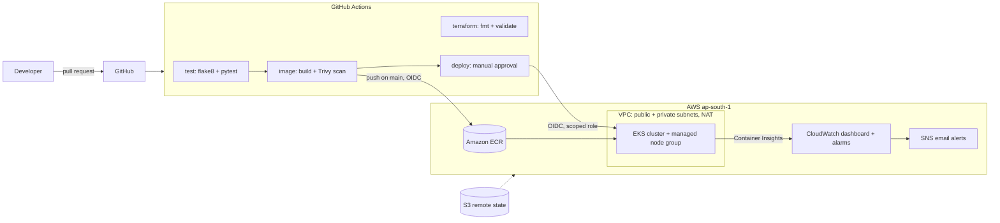

# DevOps Project: Containerized App on EKS

Flask API deployed to AWS EKS using Terraform, GitHub Actions, Docker, Kubernetes and CloudWatch.

## Status
- [x] Step 1: Repo, app, Dockerfile
- [x] Step 2: Terraform infra (VPC, EKS, ECR)
- [x] Step 3: GitHub Actions pipeline
- [x] Step 4: Deploy to EKS
- [ ] Step 5: CloudWatch monitoring
- [ ] Step 6: Docs and architecture diagram

<!-- redeploy -->

# DevOps Project: Containerized API on AWS EKS


A small Flask API taken through a complete DevOps lifecycle: containerized with Docker, infrastructure built with Terraform, tested and shipped by GitHub Actions, deployed to Kubernetes on AWS EKS, and monitored with CloudWatch.

The application is deliberately simple. The point of the project is the platform around it.

## Architecture



## What it uses

| Area | Tools |
|---|---|
| Source control | Git, GitHub (protected `main`, pull requests, required checks) |
| Containers | Docker (multi-stage build, non-root user, healthcheck), docker compose |
| Infrastructure as code | Terraform (modules, S3 remote state with native locking) |
| Cloud | AWS: VPC, EKS, ECR, IAM, S3, SNS |
| CI/CD | GitHub Actions with OIDC (no stored AWS keys) |
| Orchestration | Kubernetes, Kustomize |
| Observability | CloudWatch Container Insights, dashboard, alarms |
| Security | Trivy image scan, least-privilege IAM roles, immutable image tags |

## Repository layout

```
app/                 Flask API, tests, Dockerfile
infra/
  bootstrap/         S3 bucket for Terraform state (applied once, local state)
  modules/
    network/         VPC, subnets, NAT gateway
    eks/             Cluster, node group, IAM roles, CloudWatch add-on
    ecr/             Image repository with scan-on-push and lifecycle policy
    github-oidc/     OIDC provider and CI/deploy roles
    monitoring/      SNS topic, alarms, dashboard
  envs/dev/          The environment that wires the modules together
k8s/
  base/              Deployment, Service, ConfigMap, Kustomization
  bootstrap/         Namespace, created once by an admin
.github/workflows/   CI/CD pipeline
```

## The pipeline

| Job | When | What it does |
|---|---|---|
| `test` | every push and PR | flake8 lint and pytest |
| `terraform` | every push and PR | `terraform fmt -check` and `validate` |
| `image` | every push and PR | builds the image, scans it with Trivy; on `main` it also pushes `<commit SHA>` to ECR |
| `deploy` | `main` only, after approval | applies the Kustomize manifests to EKS and waits for the rollout |

### Design decisions

- **No long-lived AWS credentials.** GitHub Actions authenticates through OIDC and assumes short-lived roles.
- **Two roles, two trust conditions.** The image role trusts only the `main` branch and can only push to one ECR repository. The deploy role trusts only the `dev` GitHub Environment, which requires a human approval.
- **Namespace-scoped cluster access.** The deploy role has an EKS access entry limited to the `devops-app` namespace, so it cannot touch anything else in the cluster.
- **Immutable image tags.** Images are tagged with the commit SHA, and ECR refuses to overwrite a tag, so every deployment is traceable to a commit.
- **Pinned third-party action.** The Trivy action is pinned to a verified commit SHA rather than a movable tag, after finding that its tags had been affected by a supply-chain incident.
- **Private worker nodes.** Nodes have no public IPs and reach the internet through a NAT gateway.
- **Remote state with locking.** Terraform state lives in a versioned, encrypted, private S3 bucket and uses native S3 locking (no DynamoDB table).

## Run it yourself

Requirements: AWS account, Terraform 1.10+, AWS CLI, kubectl, Docker, GitHub CLI (optional).

```powershell
# 1. Run the app locally
docker compose up --build
curl.exe localhost:8080/health

# 2. Create the state bucket (once)
cd infra\bootstrap
terraform init
terraform apply

# 3. Build the environment
cd ..\envs\dev
# put alert_email = "you@example.com" in terraform.tfvars (git-ignored)
terraform init
terraform apply

# 4. Connect and create the namespace (once per cluster)
aws eks update-kubeconfig --name devops-dev-eks --region ap-south-1
kubectl apply -f ..\..\..\k8s\bootstrap\namespace.yaml
```

Then set the repository variables `AWS_REGION`, `AWS_ROLE_ARN`, `AWS_DEPLOY_ROLE_ARN`, `EKS_CLUSTER_NAME` and `DEPLOY_ENABLED=true`, and create a GitHub Environment named `dev` with a required reviewer. Merging to `main` builds and pushes the image, and the deploy job waits for approval.

### Tear down (the cluster is the expensive part)

```powershell
cd infra\envs\dev
terraform destroy -target=module.eks -target=module.network -target=module.monitoring
```

This keeps ECR and the OIDC roles, so the pipeline keeps working while the cluster is down. Set `DEPLOY_ENABLED=false` while it is destroyed.

## Cost notes

The EKS control plane, the NAT gateway and the worker nodes are the billable parts, so the environment is built for a session and destroyed afterwards. The account only allows free-tier-eligible instance types, so the node group uses `t3.small`. CloudWatch log groups are set to 7-day retention.

## Problems I ran into

- **Network drop during a long `terraform apply`.** Terraform saved `errored.tfstate`; I restored it with `terraform state push` and checked for a stale lock before re-planning.
- **Node group failed to launch.** The account only permitted free-tier instance types, so `t3.medium` was refused. Switching to `t3.small` fixed it.
- **OIDC role could not be assumed.** GitHub was sending an ID-based subject claim (owner and repo IDs included), which did not match the name-based trust policy. I printed the real token subject in a debug step and updated the policy to match.
- **CI plumbing destroyed with the cluster.** A full `terraform destroy` also removed the ECR repository and OIDC roles, which broke the next merge. Targeted destroys avoid that.
- **OOMKilled during a rolling update.** The 128Mi memory limit was too tight; limits are being raised and a `preStop` delay added for graceful shutdown.

## What I would improve next

- Split Terraform state into a permanent stack (ECR, OIDC, roles) and a throwaway stack (network, EKS, monitoring).
- Manage CloudWatch log retention in Terraform instead of by hand.
- Review which workloads the CloudWatch add-on auto-instruments.
- Add metrics-server and a Horizontal Pod Autoscaler, plus an ingress.
- Package the manifests as a Helm chart or add Argo CD for GitOps-style deployments.
